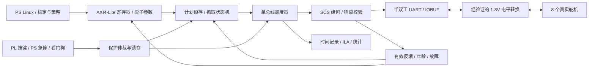

# FPGA 控制系统技术设计

状态：第一版施工设计草案，2026-10-05；尚无对应 RTL 实现。
接口偏移与字段的候选定义见 [接口修订草案](interface_proposal.md)，经双方冻结后才能作为实现契约。
本文件保留单总线硬件基础，明确纠正旧文档中“8条并行总线”和“全8路1kHz反馈”的混用。

## 1. 设计边界与数据流

PS 负责语音、视觉、引导和抓取策略，给出经过标定的预张目标、闭合目标、速度、接触阈值、动作超时与安全边界。
PL 负责参数一致性、计划锁存、固定时隙通信、有效反馈、逐通道停止、故障优先级及可观测事件。
舵机内部已有控制器；PL 通过总线读取负载并监督动作，不能据此声称实现了电机内部1kHz电流/力矩伺服。
没有标定到力的传感器时，准确名称是“基于负载反馈的接触检测与抓取监督”，报告需说明这一边界。

## 2. 第一版时钟、复位与工程集成

### 2.1 单域优先，保留原方案的比较依据

既有接口设想板载200MHz→MMCM→100MHz控制域+200MHz UART域；第一版建议让 AXI、UART、调度器、FSM 尽量共用 **100MHz**。
1Mbps 每位100个时钟周期，足以在位中心采样；200MHz过采样不能自动提高1Mbps线速。
单域能够减少多字段计划/反馈的CDC风险，仍必须核验具体Z19参考BD的时钟来源。

推荐集成候选：采用匹配Z19板卡的官方PS preset；PS主AXI→SmartConnect→自定义AXI4-Lite从机，PS `pl_clk0` 100MHz为统一逻辑时钟，`proc_sys_reset`生成同步释放的复位。
该候选不同于既有外部晶振方案；接口评审需选定一条，不能同时把两条都约束成活动主时钟。
若参考工程必须用板载晶振，则 H24/G25 的200MHz差分输入经适当输入缓冲和Clocking Wizard产生100MHz，以AXI Clock Converter连接异步AXI时钟。
不能直接把PS AXI时钟和MMCM时钟视为相同，不能用整体false path掩盖未设计的CDC。

单域下外部 `SERVO_DATA` 接收与按键仍为异步输入：RX同步器至少两级，标记 `ASYNC_REG`；同步误差纳入采样预算。
跨域多位数据若存在，使用AXI Clock Converter、异步FIFO或稳定总线+请求/确认握手；不能逐位双触发器同步完整目标数组。
计数型时钟使能替代逻辑生成新时钟；任何真实生成时钟均应有正确约束。

### 2.2 复位与异常恢复

- 上电/复位：总线输出释放，高阻接收；enable=0、计划无效、反馈全部无效；禁止主动发送运动包。
- 异步复位允许快速进入逻辑安全态，释放必须在各域同步；PS初始化不应造成无意运动。
- 复位PL不等于舵机断力矩：舵机可能继续执行上一目标，需独立供电/卸力手段。
- 急停/故障锁存后，解除按键或清CTRL位不自动恢复；需故障消除、重新确认反馈和显式清故障/使能。
- 工程必须验证PS软重启、PL重新配置、时钟丢失、应用退出后的执行器状态。

## 3. 电气与接线设计

### 3.1 已从本地手册核对的部分

| 用途 | 候选管脚 | 依据 | 施工限制 |
|---|---|---|---|
| 舵机 DATA | FMC1 LA02_P = L17，BANK68 | Z19手册 p39-40 | J5选1.8V；经电平转换；不得直连5V |
| 板载差分时钟 | H24/G25，200MHz | Z19手册 p23 | 只有采用外部晶振方案时启用对应端口/约束 |
| 心跳 | PL_LED1=B3，BANK94 | Z19手册 p54 | 极性和IO电平按板级原理图核定 |
| 保护测试按钮 | PL_KEY=D4，低有效 | Z19手册 p54-55 | p55示意图BANK44与表格BANK94不一致，按器件/原理图复核 |

LA02_N=K17只预留；第二总线不在第一版计划内。
FMC引脚属于BANK67/68、1.8V/1.2V选择有手册支持；**不把这一结论扩大成“全部PL bank都是HP且最高1.8V”**。
LED与KEY所在BANK94的IO类型、供电和上拉，应独立核对，不能照抄FMC的IOSTANDARD。
接线还须确认FMC转接板的连接器脚位与排针标签；FPGA封装球号不是转接板排针号。

### 3.2 电平转换的验收条件

既有TXS0108E方案保留为候选，不能仅凭“自动方向感应”推断总线无冲突。
TI数据表规定电压范围和OE高阻条件；自动方向器件的负载、线长、反射和边沿受具体电路影响。
8个舵机加电缆是多节点负载，需要比较A/B侧实际波形、换向死区、噪声和上电状态。
依据：[TI TXS0108E数据表](https://www.ti.com/lit/ds/symlink/txs0108e.pdf)；[TI SCEA131应用说明](https://www.ti.com/lit/an/scea131/scea131.pdf)。

PL顶层用IOBUF或等价顶层三态实现 `tx_drive_en`：发包时驱动，最后一个停止位发完后释放；不能在收包期一直输出空闲高。
TXS的OE是整组隔离/使能信号，不等同于每帧方向控制。收舵机响应时禁用OE会同时切断返回路径。
若实测TXS不能稳定工作，应另评带明确使能/方向的发送路径与接收路径；先画电路、核对1.8V兼容与总线高阻，再采购或焊接。第一版不承诺任意具体替代芯片可直接插上。

建议供电结构：板卡供自身；舵机使用独立、经额定值和峰值电流核验的电源；双方共地，避免大电流经信号地/转接板回流。
旧文档“5V/2A”仅是历史BOM候选，不能推出8路同时闭合/堵转已够用。
断电核对端子、电压、短路、地线，再分级上电；供电纹波和总线抖动分别观测。
所有真实接线/上电动作由现场人员依据核对表实施，本轮没有远程操作电源或板卡。

## 4. SCS协议必须先核验的事项

当前本地模型与上游SCS0009实现存在以下冲突，作为W1的阻断项：

| 项目 | 当前本地模型 | 上游SCS0009候选依据 | 冻结方法 |
|---|---|---|---|
| 16位字段序 | 小端 | 大端 | 读非对称值，如安全位置0x01F4；核对线上原始字节 |
| 位置范围 | 0..4095 / 360° | 1024级 / 300° | 厂商型号/固件手册＋不越机械限位的实测 |
| 反馈起点 | 0x3A..0x41 | 0x38..0x3F | 原始READ回应与独立工具交叉检查 |
| 0x30含义 | TORQUE_LIMIT | 上游为LOCK | 核验前禁止写该地址来“限力矩” |
| EEPROM地址 | 本地ID=0x03等 | 上游ID=0x05等 | 不盲写EEPROM；按确认型号核查 |
| 负载 | 直接无符号比较 | 符号与幅值需分离 | 确认方向位/幅值编码及真实负载含义 |

上游依据为开发者发布的 [rustypot SCS0009源代码](https://docs.rs/rustypot/latest/src/rustypot/servo/feetech/scs0009.rs.html)，本次查阅2026-10-05；`latest`是可变入口，后续W1必须固定到可下载的实际版本/commit和实机证据。
上游代码不是本机实物固件证明，不能只按表替换地址后立即整手运行。
固定gitlink版本的 [AmazingHand Demo](https://raw.githubusercontent.com/pollen-robotics/AmazingHand/3e8241074df3436a3044ced4881e3bb2133aa725/PythonExample/AmazingHand_Demo.py) 仅用于核对左右手、中位和1Mbps习惯；其扭矩注释与本地0/1写值也需实机确认。

W1的交付包括：型号/固件/工具版本、只读身份与反馈报文、确认字节序的非对称测试值、负载解码规则、使能/卸力的验证、返回延时/回复级别、每舵机安全位置范围。
封装成协议描述表后，Python基准/虚拟舵机/RTL/TB一起修订；不要只修改 `Reg`，因为端序、换算、错误位、连读和测试锚点分散在多个文件。
第一版协议子集：PING、READ、WRITE、SYNC_WRITE；不实现未使用的RESET/REG_WRITE/ACTION，也不把恢复出厂指令用作急停。

## 5. UART与帧模块的施工规格

### 5.1 `half_duplex_uart.sv`

候选字节接口：TX `valid/ready/data[7:0]`，`tx_busy/tx_done`；RX `valid/data/frame_error`；方向 `drive_en`；统计 `rx_overrun`。
8N1，空闲高，LSB先发，1起始位+8数据位+1停止位；100MHz/1Mbps整数分频=100。
收到低沿后在起始位中心复核，随后每位中心采样；低脉冲、错误停止位、break和持续噪声产生有界错误，不形成合法反馈。
每个字节之间可连续发送，但帧尾 `tx_done` 必须对应最后停止位完成，不能只是FIFO变空。
本机TX回波应有屏蔽/丢弃策略；RX队列溢出不能覆盖已有帧并伪装成功。
最坏换向时间和同步延迟是可配置周期数，使用实测值，不写死“ns级无冲突”。

### 5.2 `scs_protocol.sv`

帧结构 `FF FF ID LEN INSTR/ERR PARAM... CHECKSUM`，LEN=参数字节数+2，校验为低8位求和再取反。
TX接收事务描述符和已锁存payload，先计算长度/校验，再发出完整帧；不能在发送中读不断变化的AXI寄存器。
RX增量解析、限定最大长度、关联当前期待ID/数据长度/事务，只有完整校验通过才更新反馈缓存。
检测错误ID、超长、半帧、字节间超时、校验错和回波后，丢弃并重同步；迟到旧响应不能满足新ID的事务。
协议包没有事务序号：同ID的迟到响应尤其难区分，超时后设置清空/静默恢复窗口，避免立即同ID重试。
SYNC_WRITE广播不等待回复；PING/READ/WRITE是否回复，以已核验的response_status_level为准。

## 6. 总线预算与调度器

### 6.1 纠正帧长

计算以当前代码实际的“位置2B+Goal_Time2B+速度2B”连续写为依据，8N1@1Mbps每字节10µs。

| 事务 | 长度公式 | 字节数 | 纯线路时间 |
|---|---|---:|---:|
| 8路SYNC_WRITE，6B/舵机 | 6 + 2 + 8×(1+6) | 64 | 640µs |
| READ请求 | 6 + 地址1 + 长度1 | 8 | 80µs |
| 8B反馈响应 | 6 + 8 | 14 | 140µs |
| 下发＋1路READ | 64+8+14 | 86 | 860µs |
| 下发＋2路READ | 64+2×(8+14) | 108 | 1080µs |

因此原“980µs完成两路回读”结论不成立。1kHz下发＋1路回读仅剩140µs用于换向、返回延时、间隔、调度和余量，不是已经可行的实测方案。
500Hz下发＋2路回读有920µs非线路预算，仍需覆盖每事务时延和故障分支。
全8路每周期回读仅线路时间就为2400µs；单总线不能据此宣称全8路1kHz反馈。
若以后用只写2B位置帧降低负载，必须另外设置速度/Goal_Time，验证对应舵机语义并重做公平对比，不能在现有6B帧上直接套24B预算。

### 6.2 可冻结的预算公式

`T_slot >= T_sync_wire + Nread × (T_req_wire + T_return_max + T_resp_wire + T_gap_max) + T_housekeeping + T_margin`。
其中 `T_return_max` 包含从请求帧尾到首响应字节的有效等待；换向如与之重叠，不重复计数。
必须分别定义无首字节超时、字节间超时和完整事务绝对截止时间。旧“100µs无响应”不适合作整包截止：响应自身就需140µs。
正常路径和超时路径均不得占用下一时隙；参数超过周期预算时拒绝配置或故障退出，不能静默降低实际频率。
初始联调可临时用10ms周期探测；这只用于调试，最终500Hz验收需另测并签收。

### 6.3 `servo_bus_ctrl.sv`

状态候选：SLOT_START→TX_SYNC→READ_REQ→TURNAROUND→WAIT/RECV→VALIDATE→下一READ→SLOT_END。
调度使用“上一个绝对时隙起点+period”，禁止“事务做完再延时period”造成周期漂移。
保持每个通道的valid、last_good时间、年龄、连续超时计数、最新原始数据和错误，不把缺失数据写成0来伪装位置/温度。
500Hz正常模式每周期依次读2路，8路全扫8ms；关键4路模式可约4ms全扫，但另4路不能永久不读。
第一版建议保持8路公平轮询；优先关键通道的优化需规定非关键通道最大年龄，不能牺牲掉线/温度监视。
事务重试不得无限阻塞，预留诊断/卸力命令的有界优先级；记录overrun、错误和每通道最大年龄。

## 7. 抓取FSM与逐通道停止

状态编码与已有 `FsmState` 保持候选一致：IDLE=0、PREGRASP=1、CLOSING=2、HOLD=3、RELEASING=4、PROTECT=5。
“停止”作为锁存通道停止目标的动作，不必增加外部状态码。

| 状态 | 输出动作 | 正常出口 | 异常出口 |
|---|---|---|---|
| IDLE | 运动禁止，按约定轮询；卸力状态 | 合法使能与完整计划→PREGRASP | 急停/故障→PROTECT |
| PREGRASP | 下发标定后的预张目标 | 抓取计划到位→CLOSING；仅预张命令到位→IDLE | 预张超时/掉线/过温→PROTECT |
| CLOSING | 逐通道推进有限速度闭合；到接触门限后锁定该通道 | 满足队长定义的接触/位置完成组合→HOLD | 超时冻结目标并报timeout；严重故障→PROTECT |
| HOLD | 保持锁存安全目标并持续监督 | 合法release→RELEASING | 反馈过期/故障/急停→PROTECT |
| RELEASING | 下发安全释放目标 | 必需通道确认到位→IDLE | 释放超时/故障→PROTECT |
| PROTECT | 禁止运动，优先安全处置，故障锁存 | 故障消除＋显式清故障→禁用的IDLE | 不接受普通运动/重新使能绕过保护 |

状态机锁存本次动作类型，区分完整抓取与PREGRASP_ONLY；不能因复用同一状态就总是继续闭合。
计时必须基于实际时钟/有效周期；PREGRASP/RELEASING不能仅按固定延时宣称到位。
接触阈值只使用新鲜有效反馈；负载先按核验规则提取幅值，不把方向位当大负载。
接触判断可加连续样本数、滞回和最小闭合时间；三者是待标定配置，不能照搬模拟常数。
单指先接触后，采用“逐通道停止+整手完成组合”作为候选，避免一处接触就把整手报成抓稳。
若队长选择第一版整手接触即停，必须单独验证该对象不会漏抓，并在接口/结果中明确这一简化。
空载到位仅说明动作完成；不直接说明夹住物体。状态 `grasped` 需满足已冻结接触组合，实物稳定抓稳还需现场观察。
超时保持不设置grasped；温度/掉线/过载保护在 **全部状态** 生效，不能只在HOLD检查。
不能在掉线时对空集合 `all()` 得到true而宣称到位；每个必需通道必须valid且年龄合格。

## 8. 保护响应的真实边界

保护优先级候选：物理急停/硬故障→PS急停/看门狗→反馈失效/过温/过载→释放→普通运动。
PL按键可作为保护输入测试；同步后立即锁存按下事件，消抖主要用于释放和重新使能，避免长消抖延迟停止。
应用看门狗通过显式heartbeat写入刷新，普通读取/后台轮询不能维持失效应用的使能。
所有保护都需区分：逻辑停止提交、总线安全指令发送、舵机执行、实际机械停止。逻辑禁止TX驱动不是卸力。

响应延迟应分解为：

`T_physical <= T_feedback_age_max + T_decision + T_current_frame_max + T_safety_packet + T_servo_execute`。

异步急停不等待反馈，第一项可省；若电气/总线故障使安全帧到不了，则上式不再给出机械停止保证。
当前64B帧可占640µs，不能安全地在任意字节中间截断后马上发另一帧；若先释放总线，需经静默/解析恢复窗口发送安全帧。
候选正常策略为优先级抢占队列但在合法帧边界切换，异常线路情况下由现场独立电源切断/卸力手段处置。
保持时断力矩可能掉物；第一版限定受支撑、低位、队长确认的安全物体。掉线/过温的动作策略需共同签收，不对未知对象自行采用突然释放。
不要写“立即机械断力矩”“总线失效仍保证停止”或“微秒保护”而没有对应实测和独立执行路径。

## 9. PS↔PL一致性与可观测性

AXI写地址与写数据独立握手，缓存配对；WSTRB按字节生效；B/R通道背压期间数据稳定。
影子目标/预张/速度/阈值/行程写完后，一次CMD提交；active计划在周期边界原子生效，禁止混合新旧8路目标。
参数无效、运动中非法命令、未对齐地址和未实现地址有确定错误；不能自动将非法ID或越界位置截位变成有效动作。
反馈提供原子快照和序号，PS不能把不同时刻的位置、负载、状态混成一条采样记录。
建议中断sticky原因+mask+W1C；第一版Host可轮询，`/dev/mem`本身不是中断驱动。若启用中断，需UIO/驱动和设备树配套验证。
IRQ清除与新事件同周期应保留新事件，避免W1C吞掉保护事件。
依据：[AMD AXI参考指南 UG1037](https://docs.amd.com/v/u/en-US/ug1037-vivado-axi-reference-guide)。

建议记录：cycle_seq、自由运行时间戳、周期起点时间、周期间隔min/max、overrun、校验/超时计数、反馈年龄、保护事件码和动作序号。
时间单位和回绕必须在接口明确；只读一个“循环计数”无法得到真实P99抖动。
ILA同时观测内部条件、FSM、drive_en、TX/RX和时间戳；示波器看电平/边沿/换向。
ILA采集范围/深度/采样时钟需入报告，无逻辑分析仪不阻止这些验证。

## 10. 延后项目与优化准入

1kHz/1路回读只有在完整正常/故障事务预算均成立、反馈年龄符合抓取要求后才可启用。
多总线必须实际拆分布线与供电/ID映射，增加转换通道并重新做总线对比，不能仅在RTL复制实例就宣称并发8路。
提高波特率需实物和固件支持；所查上游SCS0009列出的最高档为1Mbps，不把更高波特率作为已可用兜底。
DPU不是第一版依赖，不套用其他板卡的overlay；之后按器件、DDR/时钟、工具/IP、Linux运行时和模型联合评估。
