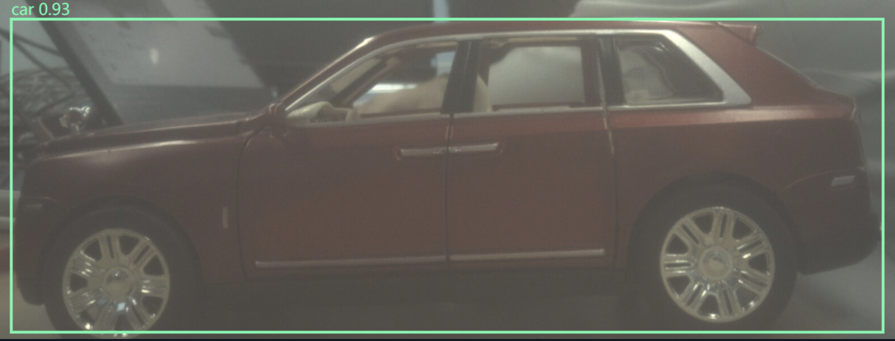
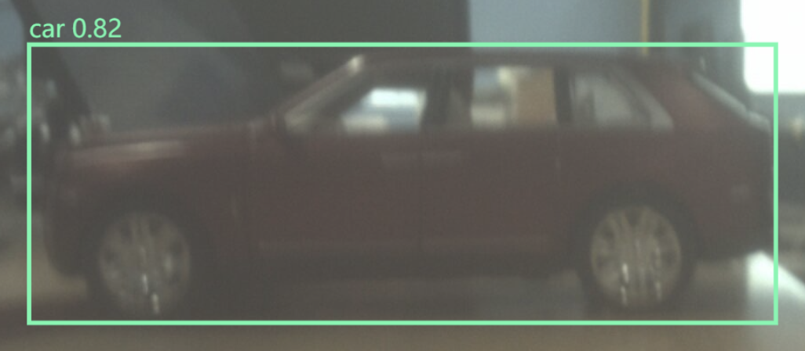

# Z19 IMX214 / YOLOv8n NCNN demo (Issue #16)

Inference runs on the Z19 A53 CPU, in a persistent native process. Python 3.7.6
and OpenCV 3.4.3 remain unchanged. The PC browser only draws returned coordinates
on the exact JPEG included in the same result. This demo never imports or sends
hand-control commands. `autonomous_grasp_allowed` is always false.

Display classes: `apple`, `banana`, `bottle`, plus `car` for the user's available
red model car. `car` is a demo-only COCO mapping; no grasp-table entry is added.

For team code review, begin with [the short review guide](REVIEW.md): minimum
read-only reproduction, exact measurement scope, dependency licenses, object
acceptance status and integration boundaries. Historical performance evidence
belongs to deployed HEAD `b996ac5`; a later UI-only fix is identified separately.

## Data and failure contract

`PreviewCamera` reads the existing `/status.json` and `/frame.jpg`. New additive
JPEG headers (`X-Sequence`, `X-Capture-Monotonic`, `X-Frame-Age-Ms`,
`X-Camera-Session`, `X-Frame-Width`, `X-Frame-Height`, copy/encode timings) bind
identity and geometry to the locked JPEG snapshot. Old HTTP servers
without headers fail explicitly; a separate status response is never used to
guess which JPEG was fetched. Existing `/stream.mjpg` and camera controls remain.

The producer has one waiting slot and drops older waiting frames. HTTP errors,
no frames, repeated/reordered sequences, camera restarts, invalid JPEGs and stale
frames suppress detections. Source age includes a conservative HTTP transit
bound plus local monotonic elapsed time; PC and board clocks are never subtracted.
Source limit defaults to 800 ms, completed-result limit to 1600 ms. Expired
results clear the image/boxes and say `STALE`; model failures say `MODEL_ERROR`.
Low confidence produces `NO_TARGET`. Every state prohibits autonomous grasping.

`/result.json` reports `frame_seq`, session, frame age, category, confidence,
`bbox_xyxy` in original JPEG pixels, total inference time, native inference time,
backend, machine architecture, board hostname, service/bridge PIDs, accumulated
FPS, CPU seconds and current RSS for service + bridge. Native timing includes
letterbox, NCNN and NMS; total timing additionally includes JPEG IPC and decode.
Separate `source_timings_ms`, `native_timings_ms` and `bridge_timings_ms` expose
HTTP reads, source decode, native decode/preprocess/forward/postprocess and IPC.
`bridge_input_bytes` reports bytes separately from milliseconds.
The independent original camera service's resource use is not included in RSS.
`jpeg_sha256` identifies the decoded browser source. No PC inference occurs.

## Reproduce model export on a PC

Use a new isolated environment, never install these into the board Python.
The tested export tools are Ultralytics 8.3.6, CPU Torch 2.14.1, NCNN 1.0.20250503
and the **explicit** pnnx 20250430 package executable. Pin dependencies for repeat
exports; the generated manifest records actual versions and converter hash.

```powershell
uv venv --python 3.12 tmp/vision-export-new
uv pip install --python tmp/vision-export-new/Scripts/python.exe ultralytics==8.3.6 ncnn==1.0.20250503 pnnx==20250430 --torch-backend cpu
# Only for a trusted official Ultralytics weight; Torch >=2.6 changes torch.load defaults.
$env:TORCH_FORCE_NO_WEIGHTS_ONLY_LOAD='1'
tmp/vision-export-new/Scripts/python.exe tools/export_yolo_ncnn.py --output-root tmp/export-new --pnnx tmp/vision-export-new/Lib/site-packages/pnnx/pnnx.exe
```

The output root must not exist. Weights, converter, export debug products and
Ultralytics settings are isolated there. Existing root `yolov8n.pt`, if present,
is copied without overwrite and described as an existing local input, with its
hash. Otherwise the script downloads the official v8.3.0 YOLOv8n asset. Export
is FP32, square 416, decoded `in0`/`out0`, 4 box values + 80 class scores. Runtime
verifies input size and SHA256 of both model files against `manifest.json`.

Model/software licensing: [Ultralytics AGPL-3.0 or Enterprise terms](https://www.ultralytics.com/license),
[NCNN BSD-3-Clause](https://github.com/Tencent/ncnn/blob/20250503/LICENSE.txt).
Do not assume conversion removes upstream model obligations.

## Isolated ARM64 build, without system package installation

Copy the task's `host/app/vision`, `host/app/__init__.py`, `host/camera_linux`
Python/native bridge sources, model param/bin/manifest, and NCNN 20250503 sources
into a **new** deployment directory. The tested directory is
`/opt/amazinghand/live-vision-20261018`; original camera and HIL packages remain.

Official NCNN source ZIP:
`https://codeload.github.com/Tencent/ncnn/zip/refs/tags/20250503`
SHA256 `d2b6250aedbd9014fe3e03d7206758e99c6337d73c5b27b24bcbf64220dc9d26`.
No Vulkan, DPU or training is used. The build profile enables exported model
layers plus NCNN internal helpers; unrelated 1D/3D/recurrent layers are disabled.

The board already has GCC 9.2, CMake 3.15, OpenCV development files and
`/usr/lib/libgomp.so.1`, but lacks OpenMP development headers/linker symlink.
Use a private generated header with the existing runtime; no `/usr` writes:

```powershell
curl.exe -L --fail -o tmp/omp.h.in https://raw.githubusercontent.com/gcc-mirror/gcc/releases/gcc-9.2.0/libgomp/omp.h.in
python tools/prepare_ncnn_openmp.py tmp/omp.h.in tmp/private-omp-new
# Copy this new private directory to the board deployment; retain the GCC notices.
```

The helper enforces upstream template SHA256. Linux AArch64 lock sizes/alignment
follow [GCC 9.2 Linux ABI](https://github.com/gcc-mirror/gcc/blob/releases/gcc-9.2.0/libgomp/config/linux/omp-lock.h).
Compile and execute the generated probe **on the board first**:

```sh
export PATH=/usr/sbin:/usr/bin:/sbin:/bin
D=/opt/amazinghand/live-vision-20261018
g++ -I"$D/private-omp" -fopenmp -c "$D/private-omp/probe.cpp" -o "$D/private-omp/probe.o"
g++ "$D/private-omp/probe.o" /usr/lib/libgomp.so.1 -o "$D/private-omp/probe"
"$D/private-omp/probe"  # must report OPENMP_THREADS=4, with ABI static_asserts passing
nice -n 19 sh "$D/host/camera_linux/ncnn_bridge/build_board.sh" "$D/ncnn-20250503" "$D/native-openmp" "$D/private-omp"
```

Choose a new build root each time; the helper rejects existing paths. The native
executable and static NCNN library install only below that root. The original
incomplete single-thread build is retained separately, not a validated artifact.
Without the optional private header the compiler may build single-thread NCNN;
`num_threads=4` alone is not proof of parallel execution. The bridge reports
whether OpenMP is compiled in, and uses only ARMv8 baseline instructions.
The optimized demo defaults to two inference threads, JPEG transport and a
200 ms source poll interval; the first-round baseline used three threads/BMP.

For the follow-up bridge-only build, reuse the retained validated static NCNN
prefix; do not rebuild or overwrite it. Copy new sources into a new `N` directory:

```sh
OLD=/opt/amazinghand/live-vision-20261018
N=/opt/amazinghand/live-vision-opt-20261018
# N/native must not already exist. These variables refer only to private files.
test ! -e "$N/native" || exit 1
cmake -S "$N/host/camera_linux/ncnn_bridge" -B "$N/native" \
  -DCMAKE_BUILD_TYPE=Release -DCMAKE_PREFIX_PATH="$OLD/native-openmp/local" \
  -DCMAKE_CXX_FLAGS="-I$OLD/private-omp" \
  -DOpenMP_CXX_FLAGS=-fopenmp -DOpenMP_CXX_LIB_NAMES=gomp \
  -DOpenMP_gomp_LIBRARY=/usr/lib/libgomp.so.1
cmake --build "$N/native" -- -j1
```

The native request carries the original JPEG width/height and a board monotonic
deadline. Native OpenCV actually decodes the image and rejects corrupt data or
geometry disagreement, then checks the unchanged 800 ms deadline **before** NCNN
forward. JPEG marker bytes alone are insufficient validation. The exact JPEG is
decoded only for a frame selected for inference; the single-slot producer no
longer decodes each discarded waiting frame. BMP remains a diagnostic option.

## Start, view, stop

Read actual board IP/configuration first. PL loading, driver changes, dependency
installation and system operations require the owner's approval. This task used
the already approved hash-guarded original camera loader once; no boot/SD files,
camera firmware/module/capture ELF, registers or sensor table are replaced.

Use the updated `preview_server.py` **as a new copy**, with the original validated
`capture_camera0` path. Stop the exact owned old preview process with SIGTERM
before starting the new copy; never run two captures. Its only functional change
is atomic frame metadata in HTTP. The original package is the rollback copy.
The tested HTTP listener is `0.0.0.0:9000`; original MJPEG preview still works.

First inspect `ps -eo pid,args` and `/proc/<PID>/cmdline` to identify the exact
owned preview server. Stop its foreground terminal with Ctrl+C, or send SIGTERM
only to that verified PID; wait for it and its owned capture to exit. Leave the
driver/PL loaded. The actual new-copy startup command is:

```sh
export PATH=/usr/sbin:/usr/bin:/sbin:/bin
D=/opt/amazinghand/live-vision-opt-20261018
mkdir -p /var/lib/amazinghand/log /run/amazinghand-preview
python3 "$D/host/camera_linux/preview_server.py" \
  --capture /opt/amazinghand/camera0-linux-hd-20261010/capture_camera0 \
  --bind 0.0.0.0 --port 9000 \
  --log-dir /var/lib/amazinghand/log --ram-dir /run/amazinghand-preview
```

Keep that terminal open, or use an explicitly owned detached process/log for
the same command (as in this task). Ctrl+C/SIGTERM stops its capture cleanly.
Do not run the new copy's unchanged `start_preview.py` with defaults: the
validated capture ELF deliberately remains in the original package.

```sh
D=/opt/amazinghand/live-vision-opt-20261018
OLD=/opt/amazinghand/live-vision-20261018
python3 "$D/host/camera_linux/vision_control.py" start \
  --model-dir "$OLD/models" --bridge "$D/native/ah_ncnn_bridge" \
  --threads 2 --input-transport jpeg --capture-interval-ms 200
python3 "$D/host/camera_linux/vision_control.py" status
```

From a PC with the existing verified SSH configuration:

```powershell
ssh -N -F F:/Amazing_Hand/tmp/z19-ssh-rsa-config-20261010 -L 8768:127.0.0.1:9100 z19-direct
```

Open `http://127.0.0.1:8768/`. This loopback service has no hardware-control API.
`--categories car apple banana bottle` changes display filtering only. To stop:

```sh
python3 "$D/host/camera_linux/vision_control.py" stop
```

This verifies PID start time/command identity, then requests clean exit and
cleans the bridge's owned `/run/ah-vision-*` IPC directory. It preserves logs,
models, original camera preview and firmware. Ctrl+C closes the PC tunnel.
Restarting/reverting camera service must first confirm camera ownership; PL
reconfiguration is a separate approved operation, never part of vision startup.
Service logs default to persistent `/var/lib/amazinghand/log/vision-*.jsonl`;
the PID/start-time marker is under `/run/amazinghand-vision`.

Collect same-frame JSON/JPEG and real performance from the PC without inference:
`python tools/collect_live_vision.py --seconds 30 --output tmp/vision-evidence-new`.
The output directory must be new. Raw real-world images stay local unless the
owner separately chooses to share them; a summary includes hashes and timings.

Focused checks: `python host/tests/test_live_vision.py`. Actual board results and
limitations are recorded in `docs/log/2026-10-18.md` and the validation JSON.

## Follow-up measured result, 2026-10-18

Same original 1080p camera ELF/driver/bit and 416 FP32 model; same 800/1600 ms
source/result expiry, confidence .35 and nice=0. A new board boot required a new
explicit owner approval before restoring the original camera with its guarded
loader once. No new dependency, PS clock or SD boot change was made.

| On-board profile | Preview FPS median | Detection completed FPS | Total inference median / p95 ms | Observed age median / p95 ms | AI RSS MiB |
| --- | ---: | ---: | ---: | ---: | ---: |
| Camera only, 20.46 s | 27.75 | — | — | — | — |
| Previous HEAD BMP / 3T, warm 30.49 s | 7.38 | 1.970 | 483.1 / 594.8 | 1065.0 / 1441.7 | 231.7 |
| JPEG / 3T, 30.40 s | 10.95 | 1.976 | 500.7 / 564.2 | 1027.3 / 1218.6 | 190.7 |
| JPEG / 2T / poll100, 30.15 s | 14.73 | 2.094 | 472.2 / 515.8 | 877.9 / 1157.5 | 167.3 |
| **Selected JPEG / 2T / poll200, 30.08 s** | **14.89** | **2.099** | **462.4 / 504.1** | **899.3 / 1201.6** | **166.1** |

Preview is **approximately 15 FPS**, with sampled minimum 10.93 and p95 17.92;
it is not continuously >=15. CPU remains busy: 88.26% of total four-core
capacity versus baseline 95.31%. Final median per-core usage is 88.0/88.9/88.9/87.0%;
process CPU (one-core basis) is camera180.35%, native141.65%, Python5.71%,
previewHTTP3.70%. Service+native RSS excludes the independent camera processes.
These short sequential observations do not establish guarantees or isolated
causal effects; scene, scheduling and allocator differences can affect numbers.

The 10.41 s instrumented BMP diagnostic measured producer JPEG→BGR87.04 ms,
6,220,854-byte BMP write14.20 ms, native BMP read9.02 ms, forward452.03 ms.
The final JPEG path uses about134,931 bytes/write0.78 ms; producer decode is
deferred, native JPEG decode60.67 ms, preprocess11.36 ms, forward381.62 ms,
postprocess5.76 ms (all medians). Source status/JPEG HTTP reads12.31/11.68 ms;
camera copy/encode26.19/48.10 ms. Original capture still enforces its 30 ms copy
deadline: final raw counters grew450 frames/228 copy discards/129 busy skips.
No tearing guard or obsolete-frame check was disabled to increase rate.

All56 final observer reads were LIVE with a real car box. The .5 s observer saw
56 unique valid results (1.862/s); completed inference throughput2.099/s comes
from the processed counter and can exceed the observer's sampling limit.
Observed age includes consumer sampling delay, not just publication age.
Corrupt JPEG, geometry mismatch and expired-before-forward native probes pass;
12 focused checks pass on PC and board. Full frames containing faces stay local.

Raw JSONL, per-core/process statistics, build diagnostics, source/ELF hashes and
same-frame browser proof are in the [follow-up validation](../../docs/fpga/evidence/live_vision_opt_20261018/validation.json).



The browser DOM frame/hash matched its JSON exactly. The real-time ROI screenshot
may be later than the recorded sample; it is not claimed to be that exact frame.

To repeat a read-only profile on the board, identify the currently owned preview
PID first, then choose a new output directory:

```sh
python3 "$D/tools/profile_live_vision.py" --preview-pid <verified-preview-PID> \
  --vision-url http://127.0.0.1:9100 --seconds 30 --output /var/lib/amazinghand/log/new-profile
```

For software rollback, stop with the **new** controller above, wait until its
`status` reports STOPPED, then start the retained first-round controller:

```sh
python3 "$OLD/host/camera_linux/vision_control.py" start \
  --model-dir "$OLD/models" --bridge "$OLD/native-openmp/bridge/ah_ncnn_bridge"
```

The additive preview headers work with either version. There is no reason to
reload PL or unload the driver for this software rollback. If preview itself
must revert, stop only its verified owned process and reuse the original capture
with the retained first-round HTTP copy. Neither operation rewrites original files.

## First-round measured result, 2026-10-18 (historical)

The real red model car was detected by Z19 ARM NCNN (for example car 0.93735).
A 30.172-second run yielded 58 distinct results, **1.922 fps**, total inference
median **514.4 ms** / p95 **613.0 ms**, native median **488.7 ms**, observed frame
age median **992.1 ms** / p95 **1253.0 ms**. Service + native RSS was **203.3 MiB**,
CPU **196.7% of one core**, excluding the independent HD camera process.
These are demonstration measurements, not a guaranteed video rate or latency.

Concurrent camera preview was observed around 6.46 fps with this profile, below
the historical camera-only ~25 fps. One nice=5 comparison improved preview but
slowed inference and caused frequent expired results; it was rejected and all
three native TIDs restored to nice=0. The 1600 ms expiry limit was preserved.

The user moved the camera/target during measurement, so this does not establish
continuous 30-second car recall. apple/banana/bottle have software support but
no corresponding real-object acceptance. At confidence 0.35 a close hand was
once mislabeled apple 0.3618; this is a false positive, not apple acceptance.
`--conf .5` is an optional stricter display threshold, requiring recall checks.

Actual browser screenshot, clipped to the car to avoid publishing faces:



The live screenshot can be slightly later than its recorded browser sample.
Separate DOM metadata checks confirmed each drawn canvas frame_seq and JPEG
hash matched its displayed JSON. See the full
[validation record](../../docs/fpga/evidence/live_vision_20261018/validation.json).
